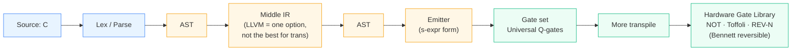

# CQ Transpiler Pipeline — Whiteboard Sketch

Transcription of the bottom-board chalkboard sketch from the discussion with
the project advisor (2026-05-21). Captures the intended end-to-end compilation
pipeline at a high level.

## Pipeline (left → right)

```
 ┌────────┐    ┌───────────┐    ┌─────┐    ┌──────────────┐    ┌─────┐    ┌─────────┐    ┌──────────┐    ┌──────────────┐
 │ SOURCE │───▶│ LEX/PARSE │───▶│ AST │───▶│   middle IR  │───▶│ AST │───▶│ EMITTER │───▶│ GATE SET │───▶│ MORE         │
 │  (C)   │    │           │    │     │    │ (LLVM = one  │    │     │    │         │    │ Universal│    │ TRANSPILE    │
 │        │    │           │    │     │    │  option, not │    │     │    │         │    │ Q-gates  │    │              │
 │        │    │           │    │     │    │  the best    │    │     │    │         │    │          │    │              │
 │        │    │           │    │     │    │  for trans)  │    │     │    │         │    │          │    │              │
 └────────┘    └───────────┘    └─────┘    └──────────────┘    └─────┘    └─────────┘    └──────────┘    └──────────────┘
     │              │              │              │              │            │              │                  │
     ▼              ▼              ▼              ▼              ▼            ▼              ▼                  ▼
 C semantics:   Classical      Tree IR    "elements/detail   Tree IR    s-expr form:   Universal      Hardware Gate
 - types        compiler                  vary"; transforms             ((q) (q)) →    quantum-gate   Library
 - memory       theory                    in different                  ((+ (+ (a b)   set            ─────────────
 - rules        (Aho/Sethi/               directions                    c))                           - Bennett rev.
 Source HLS     Ullmann)                                                                              - NOT, TOFFOLI
                LSP                                                                                   - REV-N
```

## Stage notes (verbatim board annotations)

| Stage | Board annotation |
|---|---|
| **Source** | C language. "Types, memory, rules." "Source HLS." |
| **Lex/Parse** | Standard classical compiler theory — labeled *Aho / Sethi / Ullmann* (the Dragon Book). "LSP" is noted alongside. |
| **AST (entry)** | Tree IR — picture shows a small tree sketch. |
| **Middle IR** | "Not the best for trans". LLVM identified as one possible middle IR, but flagged as suboptimal for the transformation we need. |
| **AST (exit)** | Back to tree IR after middle transformations. "Transforms — elements / detail vary." |
| **Emitter** | Lowers AST to s-expression / list form. Board shows `((q) (q)) → ((+ (+ (a b) c))` — Lisp-style nested expressions. |
| **Gate set** | "Universal Q-gates" — the target abstract gate set. |
| **More transpile** | Further transformation layer between the universal abstract gate set and concrete hardware. |
| **Hardware Gate Library** | The terminal stage. Annotations: "intro", "Q-gates", "Bennett reversible computing", "NOT", "Toffoli", "REV-N". |

## Mermaid version



## Key design takeaways

1. **AST-first, LLVM-cautious.** The middle-IR slot is open; LLVM was explicitly
   flagged as a candidate but not the best fit for the transformation we need
   (the quantum-aware lowering).
2. **AST → AST round trip is intentional.** Whatever the middle IR is, we
   re-emerge into a tree IR before the gate emitter — preserving structure that
   pure SSA/IR throws away.
3. **s-expression IR at the emitter boundary.** Once below the AST, the IR
   becomes a uniform nested-list form before lowering to gates.
4. **Two layers of "transpilation" on the gate side.** Universal abstract gate
   set first; *then* a second transpile layer maps to the concrete hardware gate
   library (NOT, Toffoli, REV-N, Bennett-style reversible).

## Related

- Phase trajectory: [ROADMAP.md](../ROADMAP.md)
- Bennett.jl comparison: [bennett-jl-comparison.md](./bennett-jl-comparison.md)
